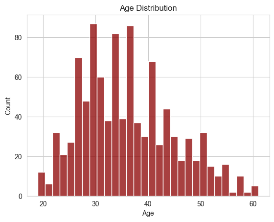
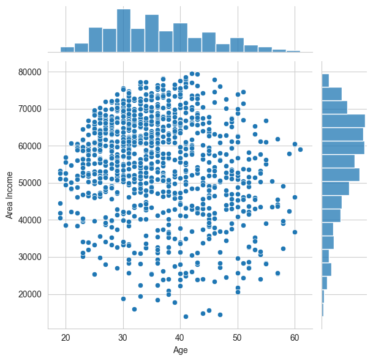
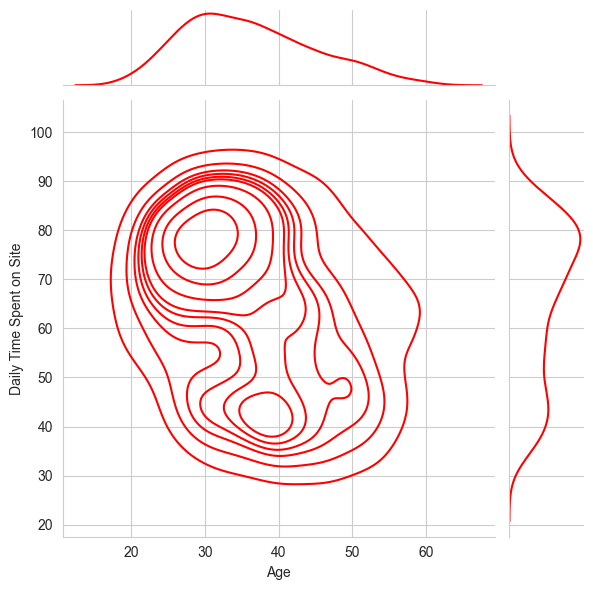
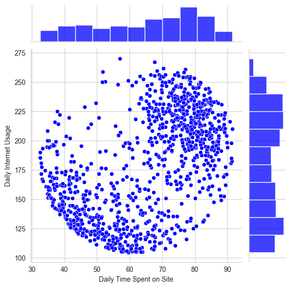
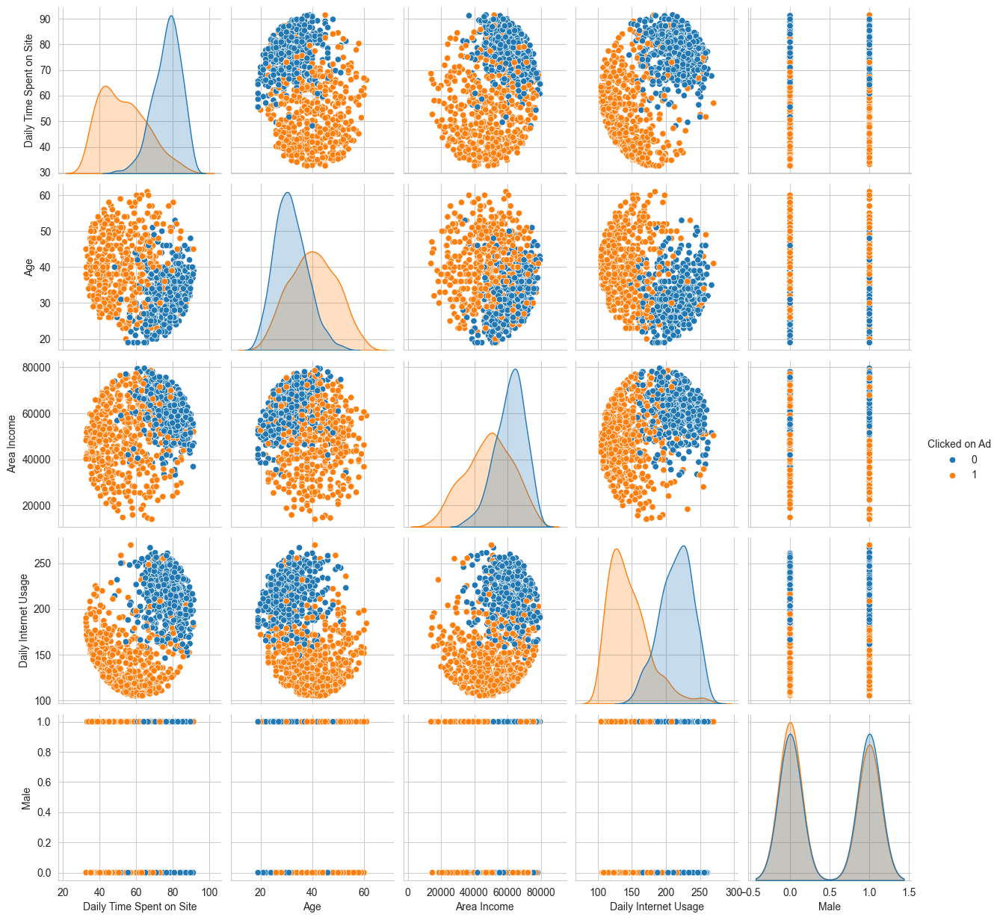

# Lab 7

### Group Members

| Names | ID |
| --- | --- |
| Arwa Alkhathlan | 2250030009 |
| Noor Albuainain | 2250030050 |
| Zainab Alharbi | 2250030246 |
| Joud Albeijan | 2250030261 |
| Sheehana Alghamdi | 2250030084 |
| Reem Alshehab | 2250030257 |

ARTI308 - Machine Learning


# Logistic Regression Project - Solutions

In this project we will be working with a fake advertising data set, indicating whether or not a particular internet user clicked on an Advertisement on a company website. We will try to create a model that will predict whether or not they will click on an ad based off the features of that user.

This data set contains the following features:

* 'Daily Time Spent on Site': consumer time on site in minutes
* 'Age': cutomer age in years
* 'Area Income': Avg. Income of geographical area of consumer
* 'Daily Internet Usage': Avg. minutes a day consumer is on the internet
* 'Ad Topic Line': Headline of the advertisement
* 'City': City of consumer
* 'Male': Whether or not consumer was male
* 'Country': Country of consumer
* 'Timestamp': Time at which consumer clicked on Ad or closed window
* 'Clicked on Ad': 0 or 1 indicated clicking on Ad

## Import Libraries

**Import a few libraries you think you'll need (Or just import them as you go along!)**


```python
import pandas as pd
import numpy as np
import matplotlib.pyplot as plt
import seaborn as seabornName
import matplotlib.pyplot as plt
import seaborn as sns
```

## Get the Data
**Read in the advertising.csv file and set it to a data frame called ad_data.**


```python
ad_data = pd.read_csv('advertising.csv')
```

**Check the head of ad_data**


```python
ad_data.head()
```


<div>
<table border="1" class="dataframe">
  <thead>
    <tr style="text-align: right;">
      <th></th>
      <th>Daily Time Spent on Site</th>
      <th>Age</th>
      <th>Area Income</th>
      <th>Daily Internet Usage</th>
      <th>Ad Topic Line</th>
      <th>City</th>
      <th>Male</th>
      <th>Country</th>
      <th>Timestamp</th>
      <th>Clicked on Ad</th>
    </tr>
  </thead>
  <tbody>
    <tr>
      <th>0</th>
      <td>68.95</td>
      <td>35</td>
      <td>61833.90</td>
      <td>256.09</td>
      <td>Cloned 5thgeneration orchestration</td>
      <td>Wrightburgh</td>
      <td>0</td>
      <td>Tunisia</td>
      <td>2016-03-27 00:53:11</td>
      <td>0</td>
    </tr>
    <tr>
      <th>1</th>
      <td>80.23</td>
      <td>31</td>
      <td>68441.85</td>
      <td>193.77</td>
      <td>Monitored national standardization</td>
      <td>West Jodi</td>
      <td>1</td>
      <td>Nauru</td>
      <td>2016-04-04 01:39:02</td>
      <td>0</td>
    </tr>
    <tr>
      <th>2</th>
      <td>69.47</td>
      <td>26</td>
      <td>59785.94</td>
      <td>236.50</td>
      <td>Organic bottom-line service-desk</td>
      <td>Davidton</td>
      <td>0</td>
      <td>San Marino</td>
      <td>2016-03-13 20:35:42</td>
      <td>0</td>
    </tr>
    <tr>
      <th>3</th>
      <td>74.15</td>
      <td>29</td>
      <td>54806.18</td>
      <td>245.89</td>
      <td>Triple-buffered reciprocal time-frame</td>
      <td>West Terrifurt</td>
      <td>1</td>
      <td>Italy</td>
      <td>2016-01-10 02:31:19</td>
      <td>0</td>
    </tr>
    <tr>
      <th>4</th>
      <td>68.37</td>
      <td>35</td>
      <td>73889.99</td>
      <td>225.58</td>
      <td>Robust logistical utilization</td>
      <td>South Manuel</td>
      <td>0</td>
      <td>Iceland</td>
      <td>2016-06-03 03:36:18</td>
      <td>0</td>
    </tr>
  </tbody>
</table>
</div>


### Use info and describe() on ad_data

> Add blockquote


```python
ad_data.info()
```

    <class 'pandas.core.frame.DataFrame'>
    RangeIndex: 1000 entries, 0 to 999
    Data columns (total 10 columns):
     #   Column                    Non-Null Count  Dtype  
    ---  ------                    --------------  -----  
     0   Daily Time Spent on Site  1000 non-null   float64
     1   Age                       1000 non-null   int64  
     2   Area Income               1000 non-null   float64
     3   Daily Internet Usage      1000 non-null   float64
     4   Ad Topic Line             1000 non-null   object 
     5   City                      1000 non-null   object 
     6   Male                      1000 non-null   int64  
     7   Country                   1000 non-null   object 
     8   Timestamp                 1000 non-null   object 
     9   Clicked on Ad             1000 non-null   int64  
    dtypes: float64(3), int64(3), object(4)
    memory usage: 78.3+ KB
    


```python
ad_data.describe()
```


<div>
<table border="1" class="dataframe">
  <thead>
    <tr style="text-align: right;">
      <th></th>
      <th>Daily Time Spent on Site</th>
      <th>Age</th>
      <th>Area Income</th>
      <th>Daily Internet Usage</th>
      <th>Male</th>
      <th>Clicked on Ad</th>
    </tr>
  </thead>
  <tbody>
    <tr>
      <th>count</th>
      <td>1000.000000</td>
      <td>1000.000000</td>
      <td>1000.000000</td>
      <td>1000.000000</td>
      <td>1000.000000</td>
      <td>1000.00000</td>
    </tr>
    <tr>
      <th>mean</th>
      <td>65.000200</td>
      <td>36.009000</td>
      <td>55000.000080</td>
      <td>180.000100</td>
      <td>0.481000</td>
      <td>0.50000</td>
    </tr>
    <tr>
      <th>std</th>
      <td>15.853615</td>
      <td>8.785562</td>
      <td>13414.634022</td>
      <td>43.902339</td>
      <td>0.499889</td>
      <td>0.50025</td>
    </tr>
    <tr>
      <th>min</th>
      <td>32.600000</td>
      <td>19.000000</td>
      <td>13996.500000</td>
      <td>104.780000</td>
      <td>0.000000</td>
      <td>0.00000</td>
    </tr>
    <tr>
      <th>25%</th>
      <td>51.360000</td>
      <td>29.000000</td>
      <td>47031.802500</td>
      <td>138.830000</td>
      <td>0.000000</td>
      <td>0.00000</td>
    </tr>
    <tr>
      <th>50%</th>
      <td>68.215000</td>
      <td>35.000000</td>
      <td>57012.300000</td>
      <td>183.130000</td>
      <td>0.000000</td>
      <td>0.50000</td>
    </tr>
    <tr>
      <th>75%</th>
      <td>78.547500</td>
      <td>42.000000</td>
      <td>65470.635000</td>
      <td>218.792500</td>
      <td>1.000000</td>
      <td>1.00000</td>
    </tr>
    <tr>
      <th>max</th>
      <td>91.430000</td>
      <td>61.000000</td>
      <td>79484.800000</td>
      <td>269.960000</td>
      <td>1.000000</td>
      <td>1.00000</td>
    </tr>
  </tbody>
</table>
</div>


## Exploratory Data Analysis

Let's use seaborn to explore the data!

Try recreating the plots shown below!

### Create a histogram of the Age


```python

sns.set_style('whitegrid')
sns.histplot(ad_data['Age'], bins=30, kde=False, color='darkred')
plt.title('Age Distribution')
plt.show()
```


    

    


### Create a jointplot showing Area Income versus Age.


```python
sns.jointplot(x='Age', y='Area Income', data=ad_data)
plt.show()
```


    

    


### Create a jointplot showing the kde distributions of Daily Time spent on site vs. Age.


```python
sns.jointplot(x='Age', y='Daily Time Spent on Site', data=ad_data, kind='kde', color='red')
plt.show()
```


    

    


### Create a jointplot of 'Daily Time Spent on Site' vs. 'Daily Internet


```python
seabornName.jointplot(x='Daily Time Spent on Site', y='Daily Internet Usage', data=ad_data, color='blue')
plt.show()
```


    

    


### Finally, create a pairplot with the hue defined by the 'Clicked on Ad' column feature.


```python
sns.pairplot(ad_data, hue='Clicked on Ad')
plt.show()
```


    

    


# Logistic Regression

Now it's time to do a train test split, and train our model!

You'll have the freedom here to choose columns that you want to train on!

### Split the data into training set and testing set using train_test_split


```python
from sklearn.model_selection import train_test_split
X = ad_data[['Daily Time Spent on Site', 'Age', 'Area Income', 'Daily Internet Usage', 'Male']]

y = ad_data['Clicked on Ad']

X_train, X_test, y_train, y_test = train_test_split(X, y, test_size=0.3, random_state=42)
```

### scaling


```python
from sklearn.preprocessing import StandardScaler


scaler = StandardScaler()
X_train_scaled = scaler.fit_transform(X_train)
X_test_scaled = scaler.transform(X_test)

```

### Train and fit a logistic regression model on the training set.


```python
from sklearn.linear_model import LogisticRegression
logmodel = LogisticRegression()
logmodel.fit(X_train_scaled, y_train)

```
<div id="sk-container-id-1" class="sk-top-container">
    <div class="sk-text-repr-fallback"><pre>LogisticRegression()</pre><b>In a Jupyter environment, please rerun this cell to show the HTML representation or trust the notebook. <br />On GitHub, the HTML representation is unable to render, please try loading this page with nbviewer.org.</b>
    </div>
    <div class="sk-container" hidden>
        <div class="sk-item">
            <div class="sk-estimator fitted sk-toggleable">
                <input class="sk-toggleable__control sk-hidden--visually" id="sk-estimator-id-1" type="checkbox" checked>
                <label for="sk-estimator-id-1" class="sk-toggleable__label fitted sk-toggleable__label-arrow">
                    <div>
                        <div>LogisticRegression</div>
                    </div>
                    <div>
                        <a class="sk-estimator-doc-link fitted" rel="noreferrer" target="_blank" href="https://scikit-learn.org/1.6/modules/generated/sklearn.linear_model.LogisticRegression.html">?<span>Documentation for LogisticRegression</span></a><span class="sk-estimator-doc-link fitted"</span>
                    </div></label>


## Predictions and Evaluations
### Now predict values for the testing data.


```python
predictions = logmodel.predict(X_test_scaled)
```

### Create a classification report for the model.


```python
from sklearn.metrics import classification_report
print(classification_report(y_test, predictions))
```

                  precision    recall  f1-score   support
    
               0       0.96      0.98      0.97       146
               1       0.98      0.96      0.97       154
    
        accuracy                           0.97       300
       macro avg       0.97      0.97      0.97       300
    weighted avg       0.97      0.97      0.97       300
    
    

## Great Job!
